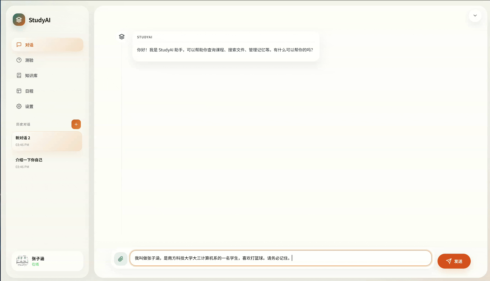
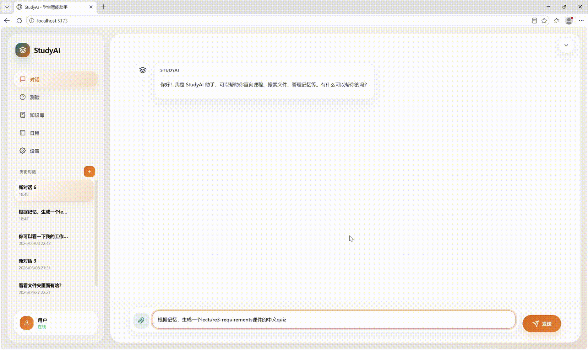
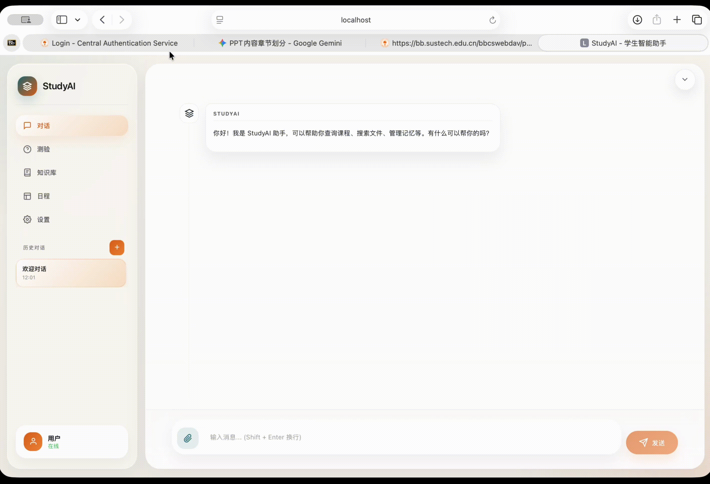
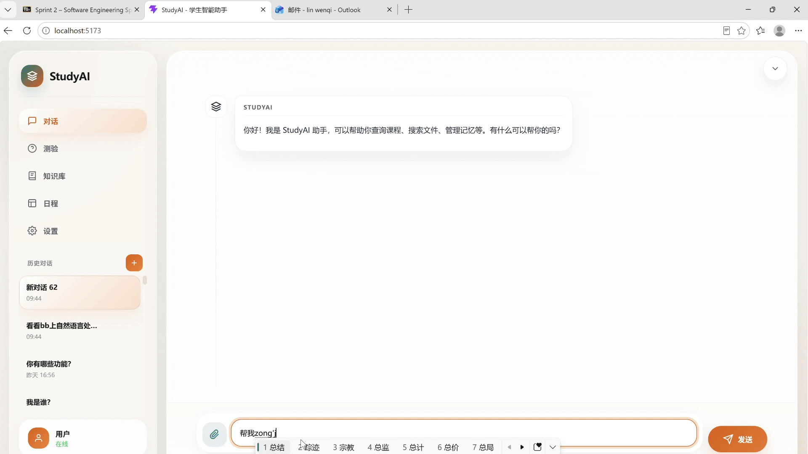
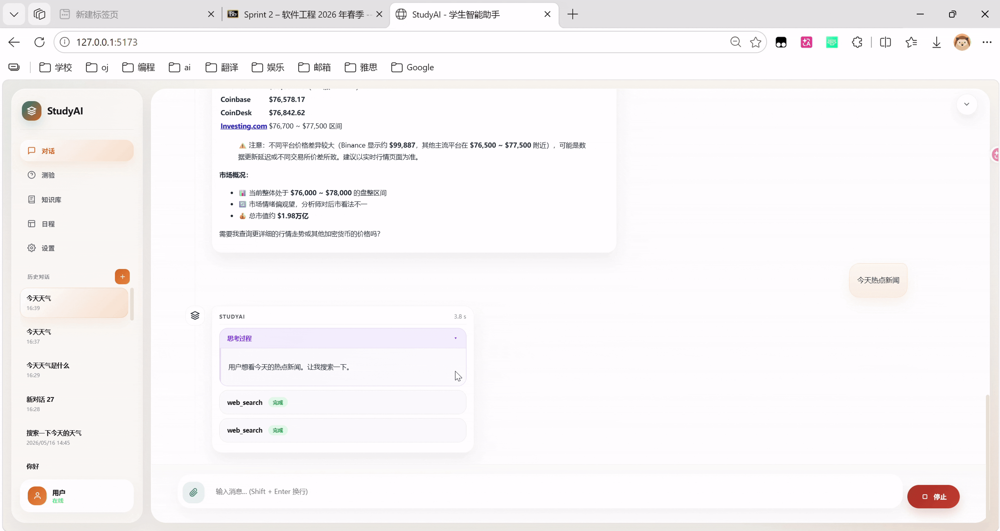

# StudyAI

> A local-first student productivity agent for SUSTech coursework, built with FastAPI, PydanticAI, and Vue 3.

StudyAI is a full-stack course project that combines an AI chat workspace with document retrieval, Blackboard integration, calendar management, quiz generation, memory, and email assistance. The system is designed for local use first: you run the backend and frontend on your own machine, configure integrations from the UI, and work through a single dashboard.


## What The Software Does

StudyAI helps a student do four kinds of work in one place:

1. Talk to an AI assistant in a persistent chat workspace.
2. Connect school systems and personal tools such as Blackboard, email, and search providers.
3. Build a local knowledge base from course materials and ask questions over those files.
4. Track study context over time through saved conversations, quizzes, calendars, and memory.

## Main Features

| Area | What is implemented |
| --- | --- |
| Chat workspace | Streaming assistant responses, visible tool events, approval-required actions, multi-conversation history, rename/delete/create conversation actions, and file upload into the current chat. |
| Settings center | UI-based configuration for LLM, Blackboard, email, and search providers; connection testing; saved profiles; apply/delete profile actions; backend health refresh. |
| Knowledge base | Index files from a shared workspace, query indexed content with citations, inspect indexed sources, and remove indexed sources. |
| Blackboard integration | Blackboard login configuration, course listing, announcement access through the agent, calendar sync, course file browsing, and file download through the backend. |
| Calendar | Unified calendar view with local events plus Blackboard events, month/day/year modes, drag-to-move local events, and clone-from-Blackboard support. |
| Quiz workflow | Agent-generated quizzes, inline answering, grading, and quiz history review. |
| User profile and memory | Local login, avatar upload, display-name editing, long-term memory browsing, and legacy memory inspection. |
| Task management | Agent-driven task tracking with progress inspection and task history. |
| Web Search | Agent can query search engines for real-time information retrieval based on configured providers. |
| Email Assistant | Agent can draft, review, and send emails via configured SMTP settings, and manage email drafts. |
| Tool Learning | Agent learns from past tool usage patterns to improve future interactions and tool utilization. |
| Persistence and inspection | SQLite-backed backend data plus a database overview panel for stored activity summaries. |

## Architecture At A Glance

- Backend: FastAPI with PydanticAI agent runtime, Pydantic data models, SQLAlchemy + SQLite, and SSE streaming.
- Frontend: Vue 3 + Vite single-page app with chat, settings, knowledge-base, calendar, quiz, task, profile, and database-overview panels.
- Storage: SQLite for application data, plus local `data/` folders for runtime artifacts.
- Retrieval: Local document parsing (markitdown) and indexing through the RAG service (raganything + text-embedding-3-small).
- Integrations: Configurable LLM providers, Blackboard Learn, email (SMTP/IMAP), and optional web search.

## Project Structure

```text
backend/
├── main.py              FastAPI entrypoint
├── config.py            Pydantic-settings configuration
├── agent/               Agent orchestration + PydanticAI runtime
├── api/                 REST routes + request/response schemas
├── db/                  SQLAlchemy models, CRUD, repositories
├── models/              Domain Pydantic models (calendar, quiz, memory, …)
└── services/            Business logic (LLM, RAG, Blackboard, email, …)
frontend/
└── src/
    ├── App.vue          Root layout
    ├── api/             HTTP client wrapper
    ├── components/      Vue components (chat, settings, calendar, …)
    └── utils/           Markdown + LaTeX rendering
tests/                   Pytest suite (21 test files)
docs/                    Architecture, feature guides, CI/CD, final report
shared/                  Local workspace for RAG and file tools
data/                    SQLite DB, RAG index, logs (gitignored)
docker-compose.yml
start-dev.sh
mkdocs.yml
pyproject.toml
.env.example
CONTRIBUTING.md
```

## Installation

### Requirements

- Python 3.11 or newer
- Node.js 20 or newer
- `uv`
- `npm`
- Optional: Docker / Docker Compose

### Get the code

```bash
git clone git@github.com:sustech-cs304/team-project-26spring-26s-8.git
cd team-project-26spring-26s-8
```

### Install backend dependencies

```bash
uv sync
```

### Install frontend dependencies

```bash
cd frontend
npm install
cd ..
```

If you also want the development and test toolchain:

```bash
uv sync --dev
```

## Running The System

### Recommended: manual startup

Start the backend:

```bash
uv run uvicorn backend.main:app
```

Start the frontend in a second terminal:

```bash
cd frontend
npm run dev
```

Then open:

- Frontend: `http://127.0.0.1:5173`
- Backend API: `http://127.0.0.1:8000/api`
- FastAPI docs: `http://127.0.0.1:8000/docs`

### Optional: startup script

The repository also includes:

```bash
./start-dev.sh
```

This script is Bash-based, so it is most convenient on macOS, Linux, WSL, or Git Bash. On pure Windows PowerShell, the manual two-terminal setup is usually easier.

### Optional: Docker

```bash
docker compose up --build
```

Container endpoints:

- Frontend: `http://127.0.0.1:80`
- Backend: `http://127.0.0.1:8000`

Mounted directories:

- `./data` for database and runtime artifacts
- `./shared` for shared workspace files
- `./BB_Files` for Blackboard downloads

## First-Time Setup In The UI

StudyAI is designed so that the main service configuration can be done from the Settings panel after the app starts.

Recommended first-use flow:

1. Start the backend and frontend.
2. Log in with the default local account (`local` / `studyai`).
3. Open `Settings`.
4. Create or edit an LLM profile, test the connection, and apply it.
5. Optionally configure Blackboard, email, and search profiles from the same panel.
6. Return to the main workspace and start using chat, knowledge base, and calendar features.

The Settings panel supports both runtime apply and saved profiles. In practice, that means you can:

- test a provider quickly for the current session
- save reusable profiles for later use
- switch between providers without retyping everything

Saved profile secrets are handled on the backend side rather than being returned to the browser.

## How To Use StudyAI

### Chat workspace

The chat workspace is the main entry point of the app. It supports:

- persistent conversation history in the browser
- multiple conversations
- streamed assistant output
- visible tool execution records
- approval banners for sensitive actions
- drag-and-drop file upload into the active conversation

Example prompts:

```text
Summarize the most important recent Blackboard announcements.
```

```text
Based on the lecture notes I just uploaded, create a 5-question quiz and explain each answer.
```

```text
Draft an email to my instructor asking for a project extension.
```

### Knowledge base

The Knowledge Base panel lets you manage indexed local materials from the shared workspace. You can:

- choose a shared folder or subfolder
- index files recursively
- test retrieval with a query box
- inspect indexed sources and their status

Supported indexed file types:

- `.pdf`
- `.docx`
- `.pptx`
- `.md`
- `.txt`

Good use cases:

- course outlines
- lecture notes
- school calendar documents
- assignment guides
- personal study notes

### Calendar

The Calendar panel merges local events with Blackboard-synced events. It supports:

- month, day, and year views
- local event creation and editing
- drag-and-drop movement for local events
- Blackboard event sync
- cloning Blackboard events into editable local events

### Blackboard files

The file browser supports Blackboard course loading and tree expansion. You can:

- list available courses
- expand course folders
- inspect nested Blackboard content
- download attached files through the backend proxy

### Quiz history

When the assistant generates quizzes in chat, the attempts are saved and can be reviewed later from the Quiz History panel.

### Profile and memory

The profile panel supports:

- display-name editing
- avatar upload
- long-term memory browsing
- legacy memory browsing
- logout

## Demo











## Optional Advanced Configuration

The app can be configured from the UI, so you do not need to edit environment variables for normal local use.

Environment variables are still useful when you want:

- reproducible team setup
- restart-safe defaults
- Docker-based deployment
- preconfigured credentials for demos

If needed, see [.env.example](.env.example) for available configuration keys.

## Testing And Quality Checks

Run backend tests:

```bash
uv run pytest
```

Run lint and format checks:

```bash
uv run ruff check .
uv run ruff format --check .
```

Verify the frontend build:

```bash
cd frontend
npm run build
```

## Known Issues And Limitations

- Blackboard, email, and web search integrations require valid external credentials (CAS account, SMTP/IMAP, or third-party API keys) that cannot be distributed with the project.
- RAG retrieval accuracy depends on the embedding model and chunking strategy; highly formatted documents (tables, multi-column layouts) may yield degraded results due to parser limitations.

## Additional Resources

> **Tip:** You can view the full documentation site locally with a searchable interface by running:
> ```bash
> uv run mkdocs serve
> ```
> Then open `http://127.0.0.1:8000` (or the port specified by mkdocs) in your browser.

### Architecture and design

- [Technical Design](docs/architecture/TECHNICAL_DESIGN.md) — system architecture, data flow, and component overview
- [Design Document](docs/architecture/design-26s-8.md) — original design with UI mockups and visual specifications
- [Database Overview](docs/architecture/DATABASE_CURRENT_OVERVIEW.md) — current database schema and relationships
- [Final Report](docs/final-report/final-report-26s-8.md) — project metrics, CI/CD pipeline, and team summary

### Feature guides

- [RAG System](docs/RAG_README.md) — local knowledge-base indexing, retrieval, and configuration
- [Email Feature](docs/features/EMAIL_FEATURE.md) — email workflow, configuration, and approval-based sending
- [Quiz Feature](docs/features/QUIZ_FEATURE.md) — interactive quiz generation, grading, and practice history
- [Blackboard Feature](docs/features/BLACKBOARD_FEATURE.md) — SUSTech Blackboard integration and course file browsing
- [Memory System](docs/features/MEMORY_SYSTEM_IMPLEMENTATION.md) — semantic search, context management, and tool learning
- [Web Search](docs/features/WEB_SEARCH.md) — search provider integration and design notes

### Development and contributing

- [Documentation Index](docs/README.md) — full docs directory listing by category
- [CI/CD Pipeline](docs/ci-cd.md) — GitHub workflow stages, security scans, and deployment gates
- [Contributing Guide](CONTRIBUTING.md) — branch strategy, commit conventions, and collaboration rules

### External references

- [Blackboard Learn REST API](https://developer.anthology.com/portal/displayApi/Learn) — official API reference for Blackboard integrations
- [FastAPI](https://fastapi.tiangolo.com/) — backend web framework
- [Pydantic-AI](https://ai.pydantic.dev/) — agent runtime and tool-calling SDK
- [Vue 3](https://vuejs.org/) — frontend framework
- [Vite](https://vitejs.dev/) — frontend build tool
- [uv](https://docs.astral.sh/uv/) — Python package and project manager

