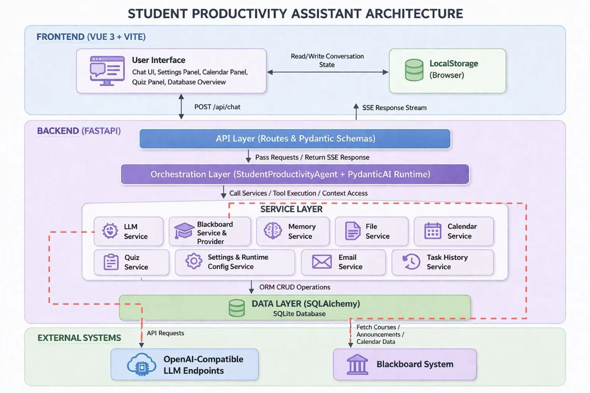
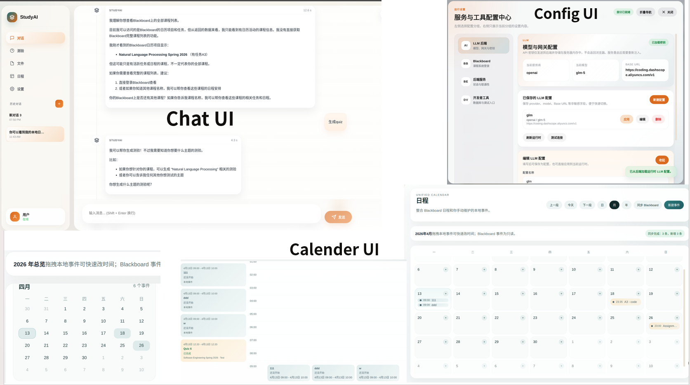
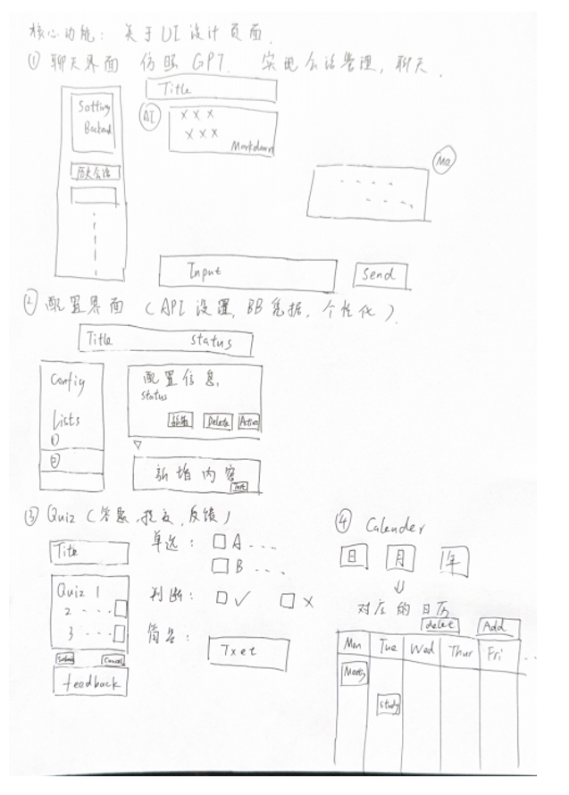

# DESIGN

## 1. Architectural Design

### 1.1 架构图（Architecture Diagram）

本项目采用前后端分离的分层架构，整体由前端、后端和外部系统三部分组成。

- 前端：基于 Vue 3 + Vite，实现用户交互与浏览器端状态管理。
- 后端：基于 FastAPI，包含 API 层、编排层、服务层和数据层。
- 外部系统：包括 OpenAI-Compatible LLM 接口和 Blackboard 系统。

Figure 1 展示了 Student Productivity Assistant 的整体架构图，体现了各层之间的职责划分以及系统交互关系。

  

### 1.2 架构设计说明（Natural Language Description）

### （1）总体设计思路

本系统采用分层架构（Layered Architecture），将系统划分为多个职责清晰的模块，包括：

- 前端负责界面与用户交互
- API 层负责请求入口与数据校验
- 编排层负责 AI Agent 推理与工具调度
- 服务层负责具体业务逻辑
- 数据层负责持久化

该设计可以有效降低模块之间的耦合度，提高系统的可维护性与扩展性。

### （2）各层职责说明

#### ① 前端层（Frontend）

前端基于 Vue 3 构建，是一个单页应用（SPA），主要职责包括：

- 提供聊天界面、设置面板、日历面板、测验面板和数据库概览等功能
- 通过 `/api/chat` 向后端发送请求
- 通过 SSE（Server-Sent Events）机制接收后端返回的响应事件并更新界面
- 使用浏览器 `localStorage` 保存会话列表、当前会话 ID 等前端本地状态

#### ② API 层（API Layer）

API 层基于 FastAPI 实现，作为系统的统一入口：

- 提供 RESTful 接口（如 `/api/chat`、`/api/settings` 等）
- 使用 Pydantic 对请求数据进行校验
- 将请求转发至编排层或服务层
- 通过 SSE 向前端返回响应

#### ③ 编排层（Orchestration Layer）

编排层是系统的核心智能模块，由 `StudentProductivityAgent` 与 `PydanticAI Runtime` 组成：

- 构建对话上下文（读取历史记录）
- 调用大语言模型（LLM）进行推理
- 动态调用各类工具（如 Blackboard、Calendar、Quiz 等）
- 管理工具调用流程及用户确认机制
- 汇总最终结果并返回

该层实现了典型的 Agent + Tool 调度机制，是系统的重要核心部分。

#### ④ 服务层（Service Layer）

服务层封装系统的具体业务能力，并隔离外部依赖，包括：

- `LLM Service`：调用大模型接口
- `Blackboard Service`：获取课程、公告和日历相关数据
- `Memory Service`：管理记忆信息
- `File Service`：处理本地文件摘要等操作
- `Calendar Service`：管理日历事件
- `Quiz Service`：生成和记录测验
- `Settings & Runtime Config Service`：管理系统设置与运行时配置
- `Email Service`：处理邮件草稿与发送
- `Task History Service`：保存对话历史

该层实现了业务逻辑与外部系统的解耦。

#### ⑤ 数据层（Data Layer）

数据层基于 SQLAlchemy 和 SQLite，实现数据持久化：

- 存储对话历史、用户偏好和记忆信息
- 管理测验数据与日历事件
- 缓存 Blackboard 数据

数据访问通过服务层进行，避免与上层直接耦合。

#### ⑥ 外部系统（External Systems）

系统依赖两个主要外部组件：

- `OpenAI-Compatible LLM Endpoints`：提供语言模型能力
- `Blackboard System`：提供课程、公告和日历数据

这些系统通过服务层进行访问，从而保持整体架构的松耦合。

### （3）设计动机（Why this architecture）

本项目采用分层架构的主要原因如下：

- 降低耦合，提高可维护性 
  将系统划分为前端、API、编排层、服务层和数据层，使各模块职责清晰，便于团队协作、开发与调试。

- 支持复杂任务与工具调用 
  相比传统“前端 -> LLM -> 返回结果”的简单结构，本系统通过编排层实现对多种工具和服务的统一调度，例如 Blackboard、Calendar、Quiz、Memory 和 File 等，从而支持更复杂的任务执行流程。

- 便于扩展与替换组件 
  外部系统和具体业务能力通过服务层封装，可以在不影响整体结构的情况下进行替换或扩展。例如，未来可以替换 Blackboard 的底层实现，或接入新的 OpenAI-Compatible LLM endpoint，而不需要重写前端或 API 层。

### （4）隐含假设（Hidden Assumptions）

虽然架构图展示了系统的主要结构，但仍存在一些未显式表达的设计假设：

- 单用户环境假设 
  当前系统主要面向单用户或本地使用场景，尚未实现完整的用户认证、租户隔离与权限管理机制。

- 本地可信执行环境 
  系统支持文件操作、命令执行和网页抓取等能力，并通过审批机制进行控制，但整体上仍默认运行环境是本地可信环境，因此未引入更严格的沙箱隔离或权限边界。

- 轻量级数据存储 
  当前使用 SQLite 作为数据库，默认系统负载较低，适用于课程项目、演示系统或本地原型环境。

- 前后端状态分离 
  前端通过 `localStorage` 保存会话列表和当前会话等本地状态，后端负责持久化任务历史、用户偏好、记忆、日历和测验等核心数据，因此前后端状态并不是完全统一的单一数据源。

- 外部系统可用性假设 
  系统默认 OpenAI-Compatible LLM 接口和 Blackboard 系统在大多数情况下可访问。当前已对部分 Blackboard 数据提供缓存支持，但整体上仍未实现更复杂的跨服务容错、重试编排或完整降级体系。

## 2. UI Design (UI 设计)

本节详细介绍了 **StudyAI** 系统的界面设计方案。设计核心在于平衡“学术专注感”与“现代交互体验”，确保用户在复杂的学习任务中保持高效。

### 2.1 总体视觉规范 (Visual Identity)

我们将系统的视觉调性定义为 **“智慧与温暖”**，通过以下规范确保全局的一致性：

- **配色方案 (Color Palette)**：
  - **主色 (Primary Color)**：选用橙色与棕色系（#D97706 / #451A03）。橙色代表活力与启发，棕色则提供稳重、类似纸张书写的阅读感。
  - **背景色 (Background)**：纯白（#FFFFFF）搭配极浅灰（#F9FAFB），确保内容层级清晰。
  - **文字颜色 (Text)**：采用深黑色（#111827）作为正文，灰色（#6B7280）作为辅助信息。
- **视觉风格 (Visual Style)**：
  - **毛玻璃效果 (Glassmorphism)**：在侧边栏和悬浮卡片中广泛应用“抛光毛玻璃”效果（Backdrop Blur），提升界面的通透感与现代感。
  - **简约原则 (Minimalism)**：移除冗余的边框线，利用阴影（Soft Shadows）和间距（Whitespace）区分组件，使界面精致且不干扰注意力。

### 2.2 布局架构 (Layout Structure)

系统主要有以下界面：

| **模块**     | **设计要点 (Design Points)** | **描述建议**                                                 |
| ------------ | ---------------------------- | ------------------------------------------------------------ |
| **Chat UI**  | **Contextual Management**    | 描述侧边栏如何管理会话生命周期（CRUD）；主区域采用气泡对话流，强调 Markdown 渲染带来的易读性。 |
| **Quiz UI**  | **Feedback Loop**            | 强调“答题-提交-反馈”的闭环。设计上应区分“练习模式”与“历史回顾模式”，说明结果页的视觉权重（如正确/错误的颜色区分）。 |
| **Calendar** | **Temporal Granularity**     | 描述年/月/日三级视图的设计逻辑。重点说明如何通过视觉元素（如小红点或色块）在不同视图下展示事件密度。 |
| **Settings** | **Config Complexity**        | 说明配置项如何分层（如 LLM 配置、个人资料），确保高频修改项（API Key）易于触达。 |

系统采用典型的 **Sidebar + Main Content (左右分栏)** 布局：

- **左侧导航栏 (Sidebar)**：集中了会话管理、Quiz 练习、文件中心、日历及设置。

- **右侧主体区 (Main Content)**：根据当前选中的功能动态切换核心交互界面。

  

### 2.3 设计工具与流程 (Design Process with Pencil.dev)

为了确保 UI 设计的科学性与可落地性，我们采用了 **Pencil.dev** 作为核心原型工具，流程如下：

1. **低保真草图绘制 (Low-fidelity Wireframing)**：在 Pencil 中快速搭建 AppShell 骨架，确定侧边栏与主区域的比例关系，不干扰于色彩，专注于功能布局。
2. **交互逻辑验证 (Interaction Mapping)**：利用 Pencil 的连接线功能，模拟从“消息发送”到“结果反馈”的跳转逻辑，确保用户路径无死角。
3. **高保真演进 (High-fidelity Evolution)**：在 Pencil 中引入最终的配色与组件尺寸规范，形成“设计稿（Manuscript）”。这为后续使用 **Vue.js** 进行组件化开发提供了精确的视觉基准，减少了开发阶段的调整成本。

UI design output

