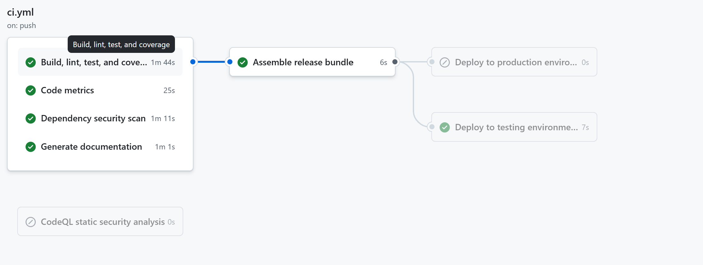
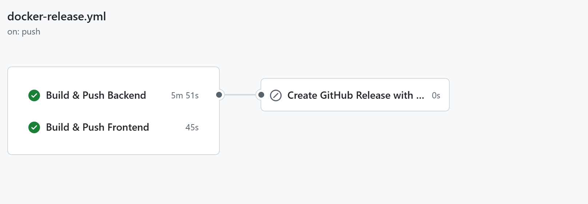

# **Team Report — CS304 Project (26s-8)**

---

## **1. Project Metrics**

To evaluate the scale, complexity, and maintainability of our project, we conducted automated metric analysis using **cloc** and **lizard**, integrated into our CI/CD pipeline.

---

### **1.1 Code Size Overview**

| Metric        | Value  |
| ------------- | ------ |
| Lines of Code | 22,660 |
| Source Files  | 77     |
| Comment Lines | 972    |
| Blank Lines   | 3,263  |

These results indicate a medium-to-large full-stack system with clear separation between backend and frontend components.

---

### **1.2 Code Distribution by Language**

| Language          | Files |   Code | Comment | Blank |
| ----------------- | ----: | -----: | ------: | ----: |
| Vue.js Components |    15 | 11,274 |     104 | 1,376 |
| Python            |    55 | 10,750 |     844 | 1,792 |
| JavaScript        |     4 |    582 |       3 |    74 |
| Dockerfile        |     2 |     39 |      21 |    21 |
| HTML              |     1 |     15 |       0 |     0 |

The system is primarily composed of:

* Python backend services (core logic, APIs, agent system)
* Vue.js frontend application (UI and user interaction layer)

---

### **1.3 Cyclomatic Complexity Analysis**

| Metric             | Value |
| ------------------ | ----- |
| Average CCN        | 3.13  |
| Functions Analyzed | 854   |
| Maximum CCN        | 33    |

The overall cyclomatic complexity is relatively low, indicating good modular design and maintainability.

The highest complexity (CCN = 33) comes from an agent task allocation function involving multiple decision branches and tool selection logic.

---

### **1.4 Dependency Overview**

| Metric                | Value   |
| --------------------- | ------- |
| Total Dependencies    | 35      |
| Backend Dependencies  | 29      |
| Frontend Dependencies | 6       |
| Runtime / Dev Split   | 25 / 10 |

Backend dependencies are managed using **uv/pip**, while frontend dependencies are managed using **npm**.

---

## **2. CI/CD Pipeline Design**

This project implements a fully automated CI/CD system using **GitHub Actions**, covering build, test, security scanning, documentation, packaging, and deployment preparation.

---

### **2.1 Repository and Workflow Links**

* Repository:
  [https://github.com/sustech-cs304/team-project-26spring-26s-8](https://github.com/sustech-cs304/team-project-26spring-26s-8)

* CI Workflow:
  [https://github.com/sustech-cs304/team-project-26spring-26s-8/blob/main/.github/workflows/ci.yml](https://github.com/sustech-cs304/team-project-26spring-26s-8/blob/main/.github/workflows/ci.yml)

* Docker Release Workflow:
  [https://github.com/sustech-cs304/team-project-26spring-26s-8/blob/main/.github/workflows/docker-release.yml](https://github.com/sustech-cs304/team-project-26spring-26s-8/blob/main/.github/workflows/docker-release.yml)

---

### **2.2 Pipeline Trigger Conditions**

The CI/CD pipeline is triggered by:

* Push events to `main`, `dev-pydanticAI`, `feature/**`, `codex/**`
* Pull requests targeting `main` and `dev-pydanticAI`
* Manual workflow dispatch

---

### **2.3 Continuous Integration Process**

The CI pipeline includes the following stages:

**(1) Source Checkout**

* Tool: GitHub `actions/checkout`

**(2) Backend Setup**

* Python 3.11
* uv package manager

**(3) Code Quality Checks**

* Ruff (lint + format check)
* Python compile validation

**(4) Automated Testing**

* Pytest
* Coverage reports (pytest-cov)

**(5) Frontend Build**

* Node.js 20
* npm production build

**(6) Code Metrics Collection**

* cloc (LOC analysis)
* lizard (cyclomatic complexity)

**(7) Security Scanning**

* pip-audit (Python)
* npm audit (frontend)
* CodeQL (optional static analysis)

**(8) Documentation Build**

* MkDocs static site generation

**(9) Artifact Packaging**

* Backend build artifacts
* Frontend dist
* Documentation site
* Metrics reports

---

### **2.4 Docker Build and Release Pipeline**

A separate workflow handles containerization and release:

* Backend Docker image build and push
* Frontend Docker image build and push
* GitHub Container Registry (GHCR) publishing
* Version tagging (`latest`, `v*`, commit SHA)

This enables reproducible deployments across environments.

---

### **2.5 Deployment Strategy**

| Environment | Trigger              |
| ----------- | -------------------- |
| Testing     | feature/dev branches |
| Production  | main branch          |

Deployment steps are currently implemented as **gates/placeholders**, ready for integration with cloud or server infrastructure.

---

### **2.6 Tools and Technologies**

| Stage               | Tools                        |
| ------------------- | ---------------------------- |
| CI/CD Orchestration | GitHub Actions               |
| Backend             | Python, uv, Pytest           |
| Frontend            | Vue.js, Node.js, npm         |
| Code Quality        | Ruff                         |
| Metrics             | cloc, lizard                 |
| Security            | pip-audit, npm audit, CodeQL |
| Documentation       | MkDocs                       |
| Containerization    | Docker, Buildx               |
| Registry            | GHCR                         |

---

### **2.7 Pipeline Execution Evidence**

Pipeline execution can be verified via GitHub Actions:

[https://github.com/sustech-cs304/team-project-26spring-26s-8/actions](https://github.com/sustech-cs304/team-project-26spring-26s-8/actions)

The screenshot below shows a successful pipeline run with all jobs passing:

**CI Pipeline:**

**Docker Release Pipeline:**

Successful runs produce:

* Test reports and coverage results
* Code metrics dashboard
* Security scan reports
* Documentation site artifacts
* Docker images and release bundles

---

## **Conclusion**

This project implements a complete full-stack engineering workflow with automated CI/CD support, including testing, security scanning, documentation generation, and containerized deployment. The system demonstrates good maintainability, modular design, and production-ready pipeline integration.
